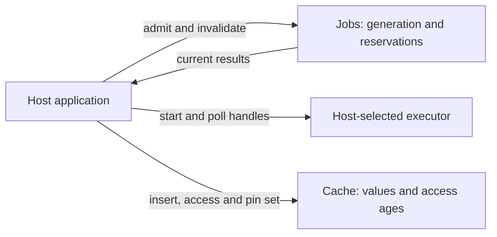

# Boundaries

This is a code boundary diagram, not a deployment or microservice diagram.

| Owner | State and guarantee | Host obligations / cost |
|---|---|---|
| `Jobs<K, T>` | Pending handles keyed by generation and request; returns only current results | Supply handles and correct completion detection; poll all pending handles; clone/order keys |
| `Cache<K, V>` | Values with access age; trim preserves pins | Set residency policy; call trim; handle excess; eviction scans entries |
| Host | Executor, worker lifetime, error representation, synchronization and pins | Enforce the meaning of one slot and handle stalled or failed workers |

The core imports only the Rust standard library. The executable demo and thread
integration test are consumers of the same public API; no executor type enters
the core. Handles can be replaced at compile time through `T` and a polling
closure. This does not imply runtime hot swapping, cancellation or compatibility
with every executor.

Both collections use ordered maps. Admission/lookup is logarithmic in tracked
entries, with additional key cloning. Polling visits all pending handles and
allocates completion/result vectors. Trimming selects a victim by scanning
entries each time, including pin-set lookups. No constant-time or measured
performance claim is made.

A separate trait hierarchy, service layer or dependency-injection framework
would add little to this two-type boundary. The host contract is expressed with
generic keys/handles and closures. See [ADR 0001](decisions/0001-retain-reservations.md)
for the important lifecycle tradeoff and its proof.
